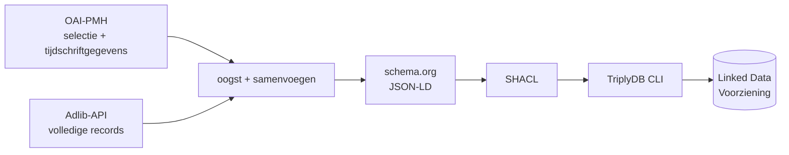

# Bibliotheek RCE ETL

Haalt de boeken en tijdschriftartikelen van de bibliotheek van de Rijksdienst voor het Cultureel Erfgoed (RCE) op, zet ze om naar
Linked Data volgens **schema.org**, toetst ze met **SHACL** en publiceert ze met een **GitHub Action** en de **TriplyDB-CLI** in de
Linked Data Voorziening van de RCE.

- Dataset: <https://linkeddata.cultureelerfgoed.nl/rce/bibliotheek>
- SPARQL-endpoint: <https://api.linkeddata.cultureelerfgoed.nl/datasets/rce/bibliotheek/sparql>

> **Status.** Gebouwd en getest op steekproeven (15.000 boeken en 300 artikelen zonder SHACL-Violations; de testsuite slaagt). Een
> volledige run en de eerste publicatie naar Triply zijn **nog niet gedraaid**. Open besluiten staan in
> [docs/besluiten.md](docs/besluiten.md); de aanpak voor de eerste runs in [docs/beheer.md](docs/beheer.md).

## Hoe het werkt



De catalogus is op twee manieren te benaderen en geen van beide is volledig:

| | OAI-PMH | Adlib-API |
|---|---|---|
| Levert | welke records openbaar zijn; bij artikelen het tijdschrift, de jaargang en de pagina's | volledige records: reeks, uitgever en plaats apart, CHT-URI's, artikeltitels |
| Mist | reeksen, artikeltitels | tijdschrift bij een artikel; weet niet wat openbaar is |

Daarom bepaalt de OAI **welke** records worden gepubliceerd, en levert het API de **inhoud**; bij artikelen worden beide samengevoegd op
het priref. Zie [docs/architectuur.md](docs/architectuur.md).

| Bron | Omvang volgens de OAI | Wordt | Graph in Triply |
|---|---|---|---|
| boeken (`books`) | 182.398 | `schema:Book` | `…/rce/bibliotheek/graphs/books` |
| artikelen (`article`) | 26.265 | `schema:Article`, met `Periodical`, `PublicationVolume`, `PublicationIssue` | `…/rce/bibliotheek/graphs/article` |

## Wat er in de data zit

Per boek onder meer titel, auteurs (persoon of organisatie, **gedeeld per naam**, dus "alle boeken van X" werkt), uitgever, plaats, jaar,
ISBN, **reeks met deelnummer**, onderwerpen (tekst en **CHT-IRI's**), plaatsen en rijksmonumentnummers. Per artikel titel, auteurs,
onderwerpen, tijdschrift, jaargang, aflevering, jaar en pagina's. Alle details staan in [docs/mapping.md](docs/mapping.md), met echte
uitvoer in [docs/voorbeelden/](docs/voorbeelden/) en voorbeeldvragen in [docs/sparql.md](docs/sparql.md).

## Snel starten (lokaal)

Vereist Python 3.12 of nieuwer.

```bash
python -m venv .venv
source .venv/bin/activate            # Windows: .venv\Scripts\activate
pip install -r requirements.txt
```

```bash
python -m pytest
```

```bash
python src/harvest_service.py --source all --max-records 100
```

```bash
python src/validate_service.py data/*.jsonld
```

De derde opdracht oogst 100 records per bron naar `data/`; de vierde toetst ze aan de shapes. Een volledige oogst duurt naar schatting
enkele tientallen minuten per bron; de gemeten duur staat in [docs/beheer.md](docs/beheer.md).

## Documentatie

| Document | Voor wie | Inhoud |
|---|---|---|
| [docs/architectuur.md](docs/architectuur.md) | ontwikkelaars | bronnen, verloop van een run, kwaliteitspoorten, publicatie, eigenaardigheden van de bronnen |
| [docs/mapping.md](docs/mapping.md) | iedereen die de data gebruikt | welk veld waar terechtkomt, adressen, wat niet wordt gepubliceerd |
| [docs/sparql.md](docs/sparql.md) | gebruikers van de data | voorbeeldvragen, plus controlequery's na publicatie |
| [docs/beheer.md](docs/beheer.md) | beheerders | inrichting, een run starten, de uitkomst lezen, foutmeldingen, terugdraaien |
| [docs/configuratie.md](docs/configuratie.md) | beheerders | elke instelling in `config/config.yml` |
| [docs/besluiten.md](docs/besluiten.md) | iedereen | open besluiten en vragen, en waarom keuzes zijn gemaakt |
| [CONTRIBUTING.md](CONTRIBUTING.md) | ontwikkelaars | werken aan de code, tests, conventies |
| [CHANGELOG.md](CHANGELOG.md) | iedereen | wat er wanneer is veranderd |

## Kwaliteitsbewaking

Een run **faalt, en publiceert dan niets**, als:

- het aantal opgehaalde records niet klopt met wat OAI en API aankondigen (of het API een record dubbel levert);
- records die de OAI publiceert in het API ontbreken, of records niet getransformeerd kunnen worden (standaard: geen enkel);
- een SHACL-**Violation** voorkomt. Warnings, zoals een boek zonder auteur, staan in de log maar blokkeren niet.

De shapes (`shacl/bibliotheek.shacl.ttl`) volgen de conventies van het
[CN-profiel](https://github.com/cultureelerfgoed/collectie-nederland-schema-profile). Details in
[docs/architectuur.md](docs/architectuur.md).

## GitHub Action

`.github/workflows/harvest_bibliotheek.yml` draait elke **maandag 03:00 UTC** en is ook handmatig te starten, met een testmodus die
niets publiceert. Vereist het secret `LDV_API_TOKEN`. Stappen: tests → oogst en SHACL per bron (parallel) → publicatie per graph
(`--mode overwrite`, daarna `merge`) → synchronisatie. **Let op:** de planning publiceert direct. Start de eerste keer handmatig met
`testmode` aan, en daarna een volledige run met `publish` uit; zie [docs/beheer.md](docs/beheer.md).

De dataset bevat al een oudere conversie in andere graphs (`bib`, `bib-series`, ...). Die worden niet aangeraakt; oud en nieuw zijn
te koppelen via de catalogus-link ([docs/sparql.md](docs/sparql.md)).

## Inhoud van de repository

```
.github/workflows/harvest_bibliotheek.yml   de workflow
config/config.yml                           alle instellingen
src/                                        oai_client, adlib_client, transform_service, harvest_service,
                                            validate_service, uris
shacl/bibliotheek.shacl.ttl                 de shapes
tools/maak_voorbeelden.py                   genereert docs/voorbeelden/ uit de testrecords
tests/                                      pytest; echte records in tests/fixtures/
docs/                                       documentatie en voorbeelden
```

## Herkomst, licentie en contact

De opzet volgt [kunstcollecties-etl](https://github.com/cultureelerfgoed/kunstcollecties-etl); de OAI-logica is afgeleid van
[oai_harvester-voor-Collectie-Nederland](https://github.com/cultureelerfgoed/oai_harvester-voor-Collectie-Nederland), zonder het interactieve deel.

**Licentie van de code:** [GPL-3.0](LICENSE), dezelfde als de kunst-ETL. Dat geldt voor de code, niet voor de data: de licentie van de
metadata (`LICENSE_URI` in de config) is nog niet bepaald; zie [docs/besluiten.md](docs/besluiten.md).

**Contact:** Infodesk van de RCE, thesauri@cultureelerfgoed.nl.
