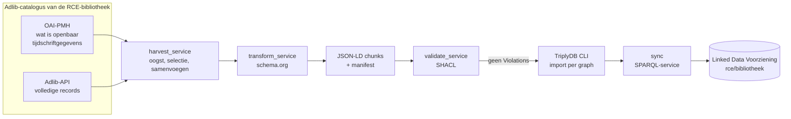

# Architectuur

Dit document beschrijft hoe de pijplijn in elkaar zit en waarom. De mapping zelf staat in [mapping.md](mapping.md), het
dagelijks beheer in [beheer.md](beheer.md).

## Overzicht

De hele keten draait in één GitHub Action ([beheer.md](beheer.md)): eerst de tests, dan de oogst per bron, dan pas de publicatie.
Faalt een stap, dan stopt de keten en blijft de Linked Data Voorziening zoals ze was.

## Waarom twee bronnen

De catalogus is op twee manieren te benaderen, en geen van beide is volledig.

| | OAI-PMH | Adlib-API |
|---|---|---|
| Adres | `rce.adlibhosting.com/oaiapi/oai.ashx` | `rce.adlibhosting.com/harvest/wwwopac.ashx` |
| Records | 182.398 boeken, 26.265 artikelen | 337.345 (alles in de database) |
| Pagina | 10 records | 500 records |
| Boeken | Dublin Core, **zonder reeks**, plaats en uitgever door elkaar | volledig: reeks, plaats en uitgever apart, CHT-URI's |
| Artikelen | **geen titel**, wel tijdschrift, jaargang, jaar, pagina's (als BibTeX-tekst) | titel en onderwerpen, **geen tijdschrift** |
| Bepaalt | wat openbaar is | niets: bevat ook niet-gepubliceerde records |

Daarom:

- de **OAI levert de selectie** (`scope: oai`): alleen records die de OAI-set bevat, worden gepubliceerd;
- het **API levert de inhoud** van boeken en artikelen;
- bij **artikelen** komt het tijdschrift (naam, jaargang, aflevering, jaar, pagina's) uit de OAI. Beide records worden samengevoegd op
  het priref: het nummer in de OAI-identifier (`1970:200000025`) is hetzelfde als `priref="200000025"` in het API.

Hoe de OAI haar selectie maakt, is niet bekend. Dat is een open vraag aan de beheerder ([besluiten.md](besluiten.md)).

## Verloop van een run

### Boeken (`kind: book`)

1. **Selectie:** alle identifiers van de OAI-set `books` ophalen (`ListIdentifiers`, 18.000+ pagina's), in tijdvakken die tegelijk worden
   opgehaald (zie "Eigenaardigheden"). Dat zijn de te publiceren priref's.
2. **Inhoud:** alle API-records uit `api_search` ophalen (`priref<200000000 or priref>=300000000`, ongeveer 217.000), met drie pagina's
   tegelijk.
3. Per API-record dat in de selectie zit: transformeren naar schema.org. De rest telt als `out_of_scope`.
4. Priref's in de selectie die het API niet leverde: `missing_in_api` (standaard een fout). Priref's die het API zelf niet kón leveren
   omdat het record in de bron fout staat, tellen apart als `unreadable` (zie "Eigenaardigheden").

### Artikelen (`kind: article`)

1. **OAI:** alle records van de set `article` ophalen (`ListRecords`, tijdschrift, jaar, pagina's).
2. **API:** alle records uit `api_search` ophalen (`priref>=200000000 and priref<300000000`, ongeveer 120.000).
3. Per API-record dat in de OAI voorkomt: samenvoegen en transformeren.
4. OAI-artikelen die het API niet leverde: toch schrijven (zonder titel), maar tellen als `missing_in_api` (standaard een fout).

### Chunks

Elke 7.000 records (instelbaar) wordt een JSON-LD-bestand geschreven: `books-0000.jsonld`, `books-0001.jsonld`, ... Elke chunk bevat
ook de dataset- en organisatie-node, en elk record neemt al zijn eigen nodes mee. Zo is elk bestand **op zichzelf te valideren** en te
importeren. Gedeelde nodes (een auteur, een uitgever, een reeks) komen in meerdere chunks voor; bij het importeren in Triply
vallen identieke triples samen.

Een record dat tijdens de transformatie een fout geeft, laat **geen halve triples** achter: het wordt eerst in een tijdelijke graph
opgebouwd en pas bij succes toegevoegd.

## Kwaliteitspoorten

De run faalt, en publiceert dan niets, bij elk van deze gevallen:

| Poort | Controle |
|---|---|
| Volledigheid OAI | opgehaald == `completeListSize` |
| Volledigheid API | opgehaald + onleesbaar == `diagnostic/hits` |
| Dubbele API-records | een record dat twee keer wordt geleverd betekent een kapotte paginering |
| Boekhouding | weggeschreven + fouten + niet-in-API == beoogd |
| Ontbrekend in API | meer dan `MAX_MISSING_IN_API` records (standaard 0) |
| Onleesbaar in API | meer dan `MAX_UNREADABLE_IN_API` te publiceren records die het API zelf niet kon leveren (standaard 10) |
| Transformatiefouten | meer dan `MAX_RECORD_ERRORS` records (standaard 0) |
| SHACL | minstens één **Violation** in een chunk |

SHACL-**Warnings** (bijvoorbeeld een boek zonder auteur) laten de run slagen maar staan in de log. Zo blijven hiaten in de bron
zichtbaar zonder de publicatie te blokkeren.

## Publicatie

Per bron één vaste graph in `rce/bibliotheek`:

| Bron | Graph |
|---|---|
| boeken | `https://linkeddata.cultureelerfgoed.nl/rce/bibliotheek/graphs/books` |
| artikelen | `https://linkeddata.cultureelerfgoed.nl/rce/bibliotheek/graphs/article` |

Het eerste bestand van een bron gaat met `--mode overwrite` (vervangt de graph van de vorige run), de overige met `--mode merge`. Er
loopt dus niets op. Tijdens het publiceren is een graph kort onvolledig. Daarna volgt een `sync` van de SPARQL-service.

> De namen `books` en `article` volgen de bronnamen in `config/config.yml`.

De dataset bevat al een oudere conversie in andere graphs (`…/graph/bib`, `bib-aut`, `bib-corpaut`, `bib-publishers`, `bib-series`,
`bib-thesaurus`). Die worden niet aangeraakt; zie [besluiten.md](besluiten.md).

## Ontwerpprincipes

- **Deterministisch.** Het adres van een node hangt alleen af van een sleutel (priref of naam), via `uuid3`. Een tweede run levert
  dezelfde adressen op.
- **Liever falen dan stilzwijgend onvolledig.** Elke teller wordt tegen de bron gecontroleerd.
- **Niets verzinnen.** Een artikel zonder titel in de bron krijgt geen `schema:name`.
- **Interne gegevens blijven binnen.** Velden met interne notities of interne links worden niet gepubliceerd (zie [mapping.md](mapping.md)).
- **Ontwerp volgt de andere RCE-ETL's** ([kunstcollecties-etl](https://github.com/cultureelerfgoed/kunstcollecties-etl)): zelfde
  stappen (oogst → transformatie → validatie → publicatie → sync), zelfde conventies voor SHACL en URI's.

## Waar staat wat

| Bestand | Rol |
|---|---|
| `src/oai_client.py` | OAI-PMH: `ListRecords`, `ListIdentifiers`, resumption tokens, retries, gzip, parallel ophalen in tijdvakken |
| `src/adlib_client.py` | Adlib-API: parallelle paginering (let op: `startfrom` telt vanaf 1), dubbelen detecteren, tijdelijke serverfouten opnieuw proberen, onleesbare records isoleren |
| `src/transform_service.py` | de mapping naar schema.org |
| `src/harvest_service.py` | selectie, samenvoegen, chunks, boekhouding, `manifest-*.json` |
| `src/validate_service.py` | SHACL-toetsing van chunks |
| `src/uris.py` | adressen, dataset- en organisatie-node |
| `shacl/bibliotheek.shacl.ttl` | de shapes |
| `config/config.yml` | alle instellingen ([configuratie.md](configuratie.md)) |
| `tools/maak_voorbeelden.py` | genereert `docs/voorbeelden/*.ttl` uit de echte fixtures |
| `tests/` | pytest; echte records in `tests/fixtures/` |

## Eigenaardigheden van de bronnen

Gevonden tijdens de bouw, en bewust in de code opgevangen:

- **API `startfrom` telt vanaf 1.** Met stappen 0, 500, 1000 laat elke pagina één record overlappen. De client gebruikt 1, 501, 1001
  en laat de run falen bij een dubbel record.
- **Tijdelijke serverfouten.** Het API gaf in een GitHub Action eenmalig `An item with the same key has already been added.`
  (een interne fout, lokaal niet te reproduceren). De client probeert zulke fouten opnieuw; een syntaxisfout in de zoekopdracht
  (`suggestions` in het antwoord) niet.
- **De OAI-set `books` bevat ook de tijdschriftartikelen.** Van de 182.397 records hebben 26.975 een priref van 200.000.000 tot
  300.000.000, het artikelbereik, bijvoorbeeld `1964:200000001`. De OAI-set `article` (26.265 records) is daar een deel van; 710
  artikelen staan alleen in de boekenset. De boekenbron slaat dit bereik over (`exclude_priref`), het telt als overgeslagen met een
  reden in het manifest en niet als "niet in API". Gevonden in de eerste echte run; een steekproef kon dit niet laten zien.
- **OAI `GetRecord` werkt niet**, ook niet voor bestaande records. De selectie gaat daarom via `ListIdentifiers`.
- **OAI-formaten:** de server noemt vijf formaten, maar elke set accepteert er één.
- **`deletedRecord = No`:** verwijderde records zijn niet te herkennen. Daarom oogst elke run alles en vervangt de graph de vorige.
- **Een kapot record laat het API een hele pagina weigeren.** Eén boek (priref 450004680) heeft in veld `t3` de tekst `76, 85`
  waar een getal hoort. De server antwoordt dan met `Invalid integer value ... record number 450004680` in plaats van de pagina,
  ook bij een directe opvraag en ook als je maar enkele velden vraagt. De eerste volledige run viel hierop om na ruim drie uur.
  Een foutmelding die een record noemt is dus niet tijdelijk. De client deelt zo'n pagina in tweeën tot het ene record
  overblijft, slaat dat over en noemt het in het manifest (`unreadable_ids`); de rest van de pagina komt gewoon binnen. Een fout
  zonder record wordt niet omzeild. Het record moet in de catalogus worden hersteld; tot dan telt het mee tegen `MAX_UNREADABLE_IN_API`.
- **De OAI-lijst is in tijdvakken parallel op te halen.** Een lijst is anders alleen achter elkaar te lezen (elke pagina wijst naar
  de volgende), en dat duurde voor 182.000 boeken ruim drie uur (de eerste volledige run). Een pagina kost 0,2 tot 0,65 s (schommelt,
  niet met de diepte); het openen van een lijst ongeveer 1 s. De server handelt parallelle aanvragen af, dus drie tegelijk is
  ongeveer drie keer sneller: de selectie van 182.000 boeken duurde zo 66 minuten (gemeten, onder belasting en inclusief ongeveer
  6 minuten plannen) in plaats van 3u12m. `from` en `until` beperken de lijst tot een tijdvak; de planner halveert tijdvakken
  tot ze hooguit `SRC_OAI_WINDOW` records bevatten, en `SRC_OAI_WORKERS` tijdvakken worden tegelijk opgehaald.
- **`from`/`until` rekenen op hele seconden, de datestamps hebben fracties.** Sluiten twee tijdvakken met een seconde op elkaar aan
  (`[lo, mid]` en `[mid+1s, hi]`), dan valt een record op `mid` + 0,5 s in geen van beide (gevonden: 9 van 63.259). De tijdvakken
  overlappen daarom op de grens, records worden ontdubbeld op identifier, en de planner controleert dat de tellingen sluiten. Elk
  tijdvak moet bovendien precies zoveel records opleveren als de OAI vooraf meldde, en samen precies de hele lijst; anders faalt de run.
- **Het API stuurt gzip-gecomprimeerde antwoorden.** De client pakt die uit (dezelfde functie als bij de OAI); zonder uitpakken gaf
  elke pagina een parsefout.
